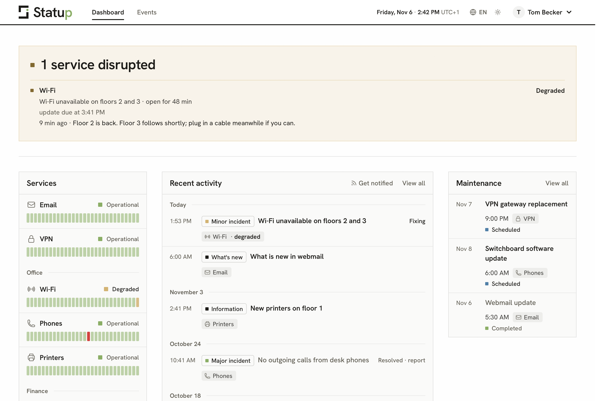
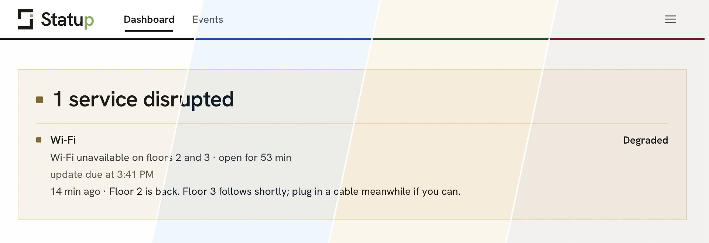

<div align="center">

<picture>
  <source media="(prefers-color-scheme: dark)" srcset=".github/assets/wordmark-dark.svg">
  
</picture>

### Every team in the loop, before anyone asks.

[](LICENSE)
[](https://github.com/karl-cta/statup/releases/latest)
[](https://www.rust-lang.org/)

[Live demo](https://demo.statup.dev) · [Website](https://statup.dev) · [Install](#install) · [Documentation](https://statup.dev/docs/)

</div>

<br>

<picture>
  <source media="(prefers-color-scheme: dark)" srcset=".github/assets/status-page-dark.png">
  
</picture>

## What is Statup?

> *"Is the internet down?"* *"Is it just me, or is Outlook broken?"*

Statup answers before anyone asks. It is a status page you host yourself: whoever runs a service posts, once, what is broken, what is planned and what has changed, and everyone else reads it in plain words, from a desk or a phone. Monitoring tools are made for the people who fix things; Statup is made for everyone else.

## Features

- **The answer first**: a banner says what is wrong, what is affected and since when, above every service and its last 90 days.
- **Notices on its own**: it checks every minute that a site or a server answers, or takes the outages your Prometheus, Grafana, Zabbix or Uptime Kuma already see.
- **Quick to publish**: incidents, planned maintenance and news, with dated updates, templates and a short report; planned work starts and ends on its own.
- **Reaches people where they are**: Microsoft Teams, Slack, Google Chat, Discord, Mattermost, ntfy, email and webhooks, plus email subscriptions, an Atom feed and a widget for your intranet.
- **For the right eyes**: public or members only, with services kept to the groups that use them.
- **Your page, your way**: your name and logo, twelve colours and four ambiances in light and dark, in French, English, German and Spanish.
- **Light and safe**: one Rust binary and one SQLite file, backups built in, an HTTP API, a Journal of who did what, Argon2id passwords and a strict Content Security Policy.

<p align="center">
  <picture>
    <source media="(prefers-color-scheme: dark)" srcset=".github/assets/themes-dark.png">
    
  </picture>
  <br>
  <sub>The same page in four of its themes.</sub>
</p>

## Install

**Docker**, with Docker Compose 2.24 or newer:

```bash
mkdir statup && cd statup
curl -O https://raw.githubusercontent.com/karl-cta/statup/main/docker-compose.yml
docker compose up -d
```

**Linux**, as a systemd service:

```bash
curl -fsSL https://github.com/karl-cta/statup/releases/latest/download/install.sh | sudo sh
```

**Windows Server**, as a Windows service, in PowerShell opened as an administrator:

```powershell
irm https://github.com/karl-cta/statup/releases/latest/download/install.ps1 | iex
```

**NixOS**: add the flake and enable its module, see [NixOS](https://statup.dev/docs/nixos/).

Then open port 3000 of your server in a browser: the first screen creates the administrator account and walks you through the page. The [documentation](https://statup.dev/docs/) has every setting, HTTPS behind a reverse proxy, backups and upgrades.

## Live demo

[demo.statup.dev](https://demo.statup.dev): sign in with `demo@statup.dev` / `StatupDemo#1` to publish as an editor. It starts over every hour.

## Contributing

Built with Rust, Axum, SQLite, Askama and htmx. The [contributing guide](.github/CONTRIBUTING.md) explains how to build Statup and the checks a change must pass. Every change is in the [changelog](.github/CHANGELOG.md).

## License

Statup is licensed under the [GNU Affero General Public License v3.0 or later](LICENSE). If you run a modified version for others over a network, offer them its source code. It ships htmx, the Hanken Grotesk font, icons from Heroicons and the base styles of Tailwind CSS, under their own licenses: see [THIRD_PARTY_NOTICES.md](THIRD_PARTY_NOTICES.md).

Statup is not related to Statping, a Go project first published under the name Statup.
